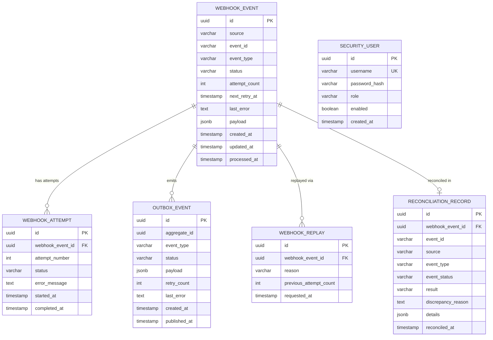
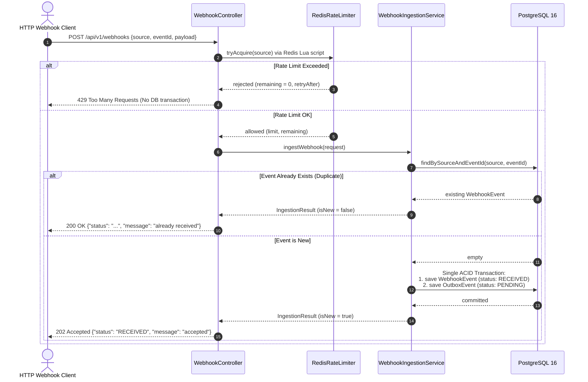
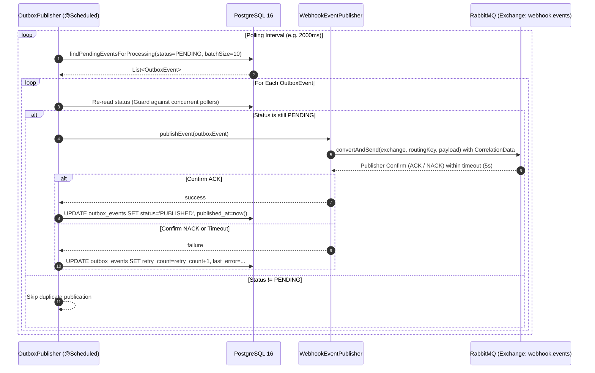
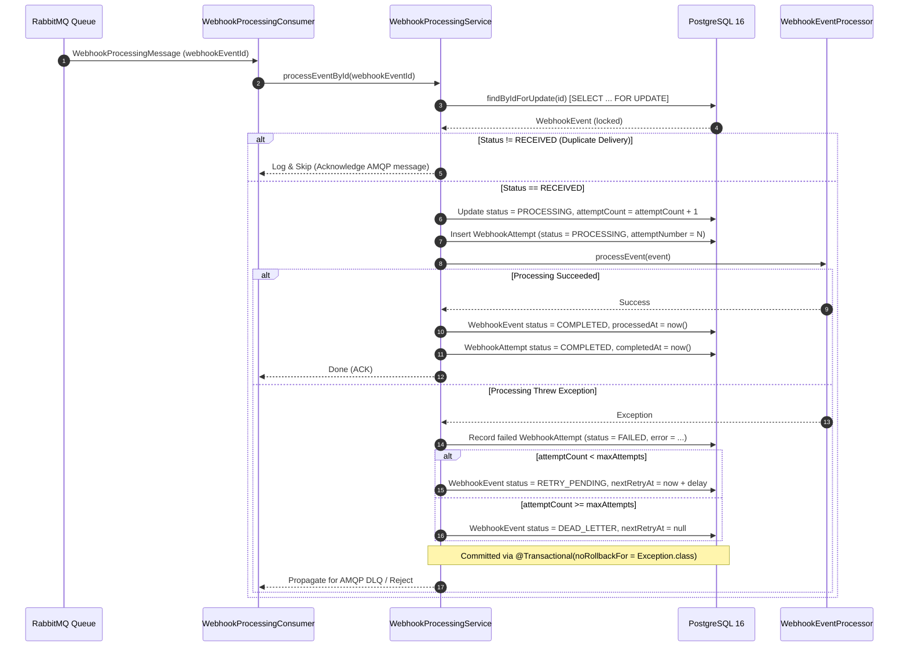
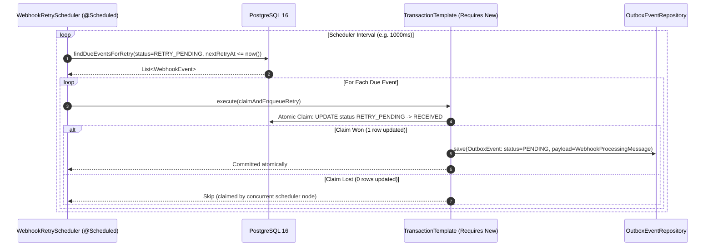
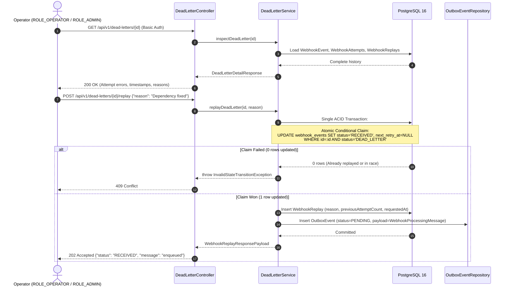
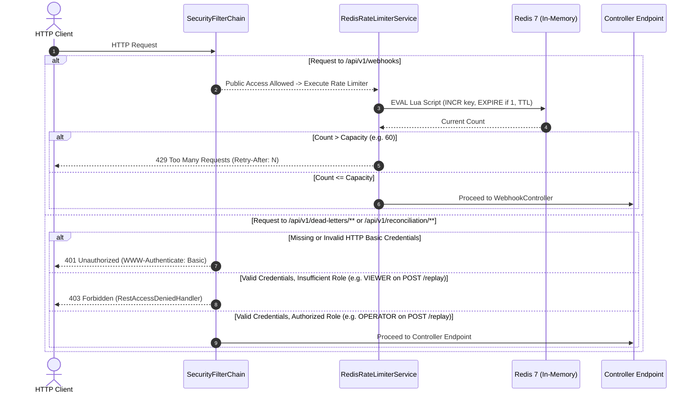
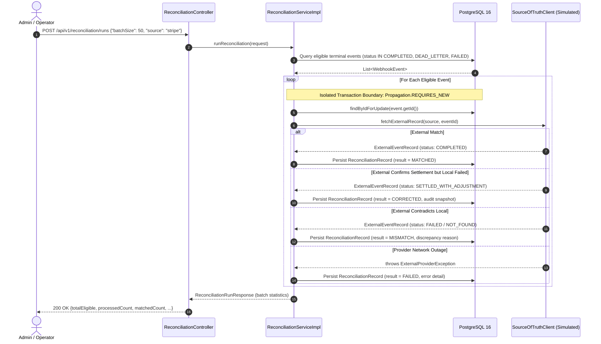

# Technical Architecture — Webhook Reconciliation Engine

## 1. System Purpose & Architectural Style

The **Webhook Reconciliation Engine** is an event-driven Java backend platform engineered to reliably receive, persist, process, and reconcile webhook events emitted by external distributed systems.

### Layered Architecture
The application adheres to a clean **layered architecture** with unidirectional dependencies:

```
┌─────────────────────────────────────────────────────────────┐
│                       Controller Layer                      │
│   (REST Controllers, DTO Validation, Rate Limiter Check)    │
└──────────────────────────────┬──────────────────────────────┘
                               │
┌──────────────────────────────▼──────────────────────────────┐
│                        Service Layer                        │
│   (Business Orchestration, Retry Engine, DLQ, Reconciliation│
└──────────────┬──────────────────────────────┬───────────────┘
               │                              │
┌──────────────▼──────────────┐┌──────────────▼───────────────┐
│       Messaging Layer       ││       Repository Layer       │
│(RabbitMQ Publishers/Consumer││ (Spring Data JPA, Row Locks) │
└──────────────┬──────────────┘└──────────────┬───────────────┘
               │                              │
┌──────────────▼──────────────┐┌──────────────▼───────────────┐
│     RabbitMQ Message Broker ││     PostgreSQL 16 Database   │
└─────────────────────────────┘└──────────────────────────────┘
```

1. **Controller Layer**: Handles HTTP ingress, validates request DTOs (`@Valid`), executes pre-flight Redis rate limit checks, and translates domain exceptions into standard HTTP error responses.
2. **Service Layer**: Orchestrates domain business logic, state transitions, transaction management, backoff calculations, replay claims, and reconciliation comparisons.
3. **Repository Layer**: Encapsulates persistence operations against PostgreSQL using Spring Data JPA, enforcing explicit concurrency controls via pessimistic row locks (`@Lock(LockModeType.PESSIMISTIC_WRITE)`).
4. **Messaging Layer**: Implements AMQP publishing and consumption with RabbitMQ using correlated publisher confirms and JSON serialization.
5. **Domain Layer**: Encapsulates core business entities, status enums, and JPA mappings.

---

## 2. Domain Model & Entity Relationships

The data model is partitioned into distinct audit trails for domain events, worker attempts, outbox publications, operator replays, reconciliation records, and operational accounts.



### Relational Schema Guarantees
- **Composite Uniqueness on Ingestion**: `UNIQUE(source, event_id)` on `webhook_events`. Providers like Stripe and Shopify may generate identical strings (`evt_123`), but collisions within the same source are rejected.
- **Strict Attempt Numbering**: `UNIQUE(webhook_event_id, attempt_number)` on `webhook_attempts`. Guarantees chronological non-overlapping attempt logs.
- **Reconciliation Audit Uniqueness**: `UNIQUE(webhook_event_id)` on `reconciliation_records` (via Flyway `V4`) to prevent duplicate audits for a single event.

---

## 3. Detailed Request and Processing Flows

### Flow 1: Webhook Ingestion & Idempotency

External producers submit webhooks to `POST /api/v1/webhooks`. Ingestion requires fast acceptance, protection against volumetric overload, and bulletproof deduplication.



#### Race Condition Handling on Ingestion
If two identical webhooks arrive simultaneously, both might execute `findBySourceAndEventId` before either has committed. Both attempt `saveAndFlush`. The PostgreSQL unique index `UNIQUE(source, event_id)` rejects the second thread with `DataIntegrityViolationException`. `WebhookIngestionService` catches this violation, re-queries the row persisted by the winner, and returns `200 OK`, preserving strict idempotency.

---

### Flow 2: Transactional Outbox & Correlated RabbitMQ Publication

Directly publishing to RabbitMQ during the HTTP request introduces dual-write failures (DB commit succeeds, broker publish fails $\rightarrow$ event lost; or publish succeeds, DB commit fails $\rightarrow$ phantom message). The Transactional Outbox pattern eliminates this vulnerability.



---

### Flow 3: Asynchronous Worker Processing & Attempt History

The consumer listens to `webhook.processing`, acquires an exclusive database lock on the event, and executes business processing.



---

### Flow 4: Retry Scheduling & Exponential Backoff Engine

Failed events enter `RETRY_PENDING` with a deterministically calculated UTC timestamp:
$$d_n = \min(d_0 \cdot m^{n-1}, d_{\max})$$
Worker threads are not held sleeping in memory. Instead, a lightweight scheduler polls PostgreSQL for due events.



---

### Flow 5: Dead-Letter Handling, Operator Inspection & Audited Replay

When `attemptCount >= maxAttempts`, automatic retries cease and the event enters `DEAD_LETTER`. Operators inspect the chronological history and safely trigger replays.



---

### Flow 6: Spring Security RBAC & Atomic Redis Rate Limiting

Ingestion traffic is protected against denial-of-service and flooding using distributed fixed-window rate limiting in Redis. Administrative endpoints are protected via stateless Spring Security HTTP Basic authentication.



---

### Flow 7: Reconciliation Workflow against Simulated Source of Truth

Reconciliation runs periodically verify internal processing results against an independent external source of truth.

> [!NOTE]
> The source-of-truth client in this phase is an abstraction (`SourceOfTruthClient`) implemented by `SimulatedSourceOfTruthClient`. It deterministically generates reference states for testing without relying on live third-party network connections.



---

## 4. Key Architectural Decisions & Rationale

### 1. Why the Transactional Outbox Pattern?
- **The Problem**: In a distributed system, a single process cannot atomically commit a row to a database and publish a message to a broker without distributed transactions (2PC / XA), which introduce severe latency and single points of failure.
- **The Decision**: Both the `WebhookEvent` and the `OutboxEvent` are written to PostgreSQL in the exact same ACID database transaction.
- **Why It Matters**: If PostgreSQL commits, the outbox record is guaranteed to exist. A background poller then dispatches the message to RabbitMQ with publisher confirms. Even if the application crashes or RabbitMQ is temporarily down, the event will never be lost.

### 2. Why At-Least-Once Delivery + Consumer Idempotency?
- **The Problem**: Distributed network partitions and acknowledgements make "exactly-once delivery" physically impossible across message brokers. If a worker finishes processing but crashes before acknowledging RabbitMQ, the broker will redeliver the message.
- **The Decision**: Accept at-least-once message delivery and enforce strict idempotency at the database boundary.
- **Why It Matters**: Workers inspect the authoritative status of the event under a row-level lock (`SELECT ... FOR UPDATE`). If the event is already `COMPLETED`, `PROCESSING`, `RETRY_PENDING`, or `DEAD_LETTER`, the worker acknowledges the AMQP delivery and skips execution. Exactly-once *processing semantics* are guaranteed without relying on unsupported broker guarantees.

### 3. Why Flyway Migrations & `ddl-auto: validate`?
- **The Problem**: Allowing Hibernate to auto-generate or alter database schemas (`ddl-auto: update`) in production causes silent schema divergence, lock contention, and untracked changes across cluster nodes.
- **The Decision**: Flyway executes immutable, versioned SQL scripts (`V1` through `V4`) during startup. Hibernate is configured strictly to `validate`.
- **Why It Matters**: Schema modifications are versioned in Git, auditable, reproducible, and tested identically across development, CI, and production.

### 4. Why Database Concurrency Controls (Row Locks & Constraints)?
- **The Problem**: Distributed workers running concurrently can pull duplicate copies of the same message or duplicate replay requests simultaneously, resulting in dual executions and inconsistent attempt counts.
- **The Decision**: Combine three distinct concurrency safeguards:
  1. **Relational Unique Constraints**: `UNIQUE(source, event_id)`, `UNIQUE(webhook_event_id, attempt_number)`, and `UNIQUE(webhook_event_id)`.
  2. **Pessimistic Row Locks (`SELECT ... FOR UPDATE`)**: In `WebhookProcessingService` and `ReconciliationServiceImpl`, serialize concurrent executions targeting the same webhook event.
  3. **Atomic Conditional SQL Updates**: In `WebhookRetryScheduler` and `DeadLetterService`, execute `UPDATE ... WHERE id = :id AND status = :expectedStatus`. Exactly one thread modifies the row; losing threads observe 0 updated rows and back off.

### 5. Why Isolated Transaction Boundaries (`TransactionTemplate` & `REQUIRES_NEW`)?
- **The Problem**:
  - In `WebhookProcessingService`, catching an exception, updating state to `RETRY_PENDING`, and then throwing an exception would normally trigger a Spring rollback, discarding the failure attempt.
  - In `WebhookRetryScheduler` and `ReconciliationServiceImpl`, internal helper methods called on `this` bypass Spring AOP transaction interceptors, causing `TransactionRequiredException` or shared transaction failure cascades.
- **The Decision**:
  - Configured `WebhookProcessingService` with `@Transactional(noRollbackFor = Exception.class)`.
  - Injected `PlatformTransactionManager` into schedulers and reconciliation services to execute discrete units of work within explicit `TransactionTemplate` instances with `PROPAGATION_REQUIRES_NEW`.
- **Why It Matters**: A failure on a single webhook during a reconciliation run commits its own `FAILED` record without rolling back or poisoning the surrounding batch.

---

## 5. Infrastructure & Resilience Components

| Component | Technology | Configuration & Resilience Features |
|---|---|---|
| **Primary Database** | PostgreSQL 16 | HikariCP connection pool (min: 2, max: 10), connection timeout 20s, UTC timestamps (`TIMESTAMP WITH TIME ZONE`), JSONB native columns. |
| **Message Broker** | RabbitMQ 3.13 | Correlated publisher confirms (`publisher-confirm-type: correlated`), publisher returns enabled, durable direct exchange (`webhook.events`), durable queue (`webhook.processing`). |
| **Distributed Cache** | Redis 7 | Standalone / Cluster support, atomic Lua scripts, configurable fail-closed policy (`RATE_LIMIT_FAIL_CLOSED=true`) returning HTTP 503 on outages. |
| **Application Runtime** | Spring Boot 3.4 / Java 21 | Graceful shutdown (`server.shutdown: graceful`, 30s timeout per phase), stateless HTTP sessions, health probes via Spring Actuator. |

---

## 6. Known Limitations & Architecture Roadmap

- **Simulated Source of Truth**: The reconciliation engine uses `SimulatedSourceOfTruthClient`. Production deployments require concrete adapters implementing `SourceOfTruthClient` for each provider (e.g., Stripe, PayPal, Shopify).
- **Cryptographic Provider Signatures**: The public ingestion endpoint validates JSON payloads and enforces Redis rate limiting, but does not yet verify cryptographic provider HMAC SHA-256 signatures (scheduled for Phase 11).
- **Non-Mutating `CORRECTED` Audits**: When reconciliation identifies an external settlement for a locally failed event, it records a `CORRECTED` audit record but preserves the internal event status to maintain historical immutability.
